 

🐟 Every fish is one of my projects. The tank never stops moving.

 

  

  

<picture>
  <source media="(prefers-color-scheme: dark)" srcset="./assets/soham_dot_dark.png">
  <source media="(prefers-color-scheme: light)" srcset="./assets/soham_dot_light.png">
  
</picture>

  

 

## 👋 Hi, I'm Soham

A **student founder** from Bareilly building products for the people tech usually reaches *last*: **students, farmers and small towns across Tier-2/3 India.**

- 🎓 **MCA** @ Invertis University, Bareilly
- 🏢 **Founder & CEO** · [NovaAddin](https://novaaddin.com)
- ☁️ **Google Student Ambassador** · Cloud & AI
- 🤝 **Sarvam AI Startup Program** member
- 🇮🇳 **MyGov Campus Ambassador** (MeitY)
- 🧪 **YC Startup School** graduate
- 🎤 **Google DevFest** speaker shortlist

### 🎯 Right Now

| Project | Current work |
|---|---|
| 🔮 **AstroAshi v2** | RAG on Gita, Quran, Bible and Guru Granth Sahib |
| 🆘 **SOS Safety Device** | One press → live GPS → police and family |
| 🛰️ **CanSat · RYIC 2026** | 700 g probe, 500 m drone drop |
| 🦅 **Idea lab** | Nano recon drone for Indian forces |

 

### 📈 THE NUMBERS

| 🏆 Hackathons | 📦 Products | 🚀 Startups | 👥 Users | 🥇 Best Result |
|:-:|:-:|:-:|:-:|:-:|
| **15+** | **15+** | **2+** | **1000+** | **SIH 2025 · Top 5 India** |

 

## 🛠️ ARSENAL

**AI stack:** Vertex AI · Gemini · Groq · Sarvam APIs · Hugging Face · RAG · pgvector · Agentic AI &nbsp;|&nbsp; **Speed tools:** Cursor · Lovable · v0

 

 

## 🚀 SHIPPED

| NovaAddin | AstroAshi | Eco Logicx |
|---|---|---|
| Peer mentorship + AI career ecosystem. Dctr Nova, resume AI and mentor marketplace. **4.8/5** across 1000+ students. [**novaaddin.com ↗**](https://novaaddin.com) | AI astrology for every faith. v1 hit **#81 on Product Hunt (worldwide)**. v2 adds cited sacred-text RAG. [**Live ↗**](https://astroashi.vercel.app/) | Vehicle overload detection. **~92% accuracy** on Cloud Run + Vertex AI + Firebase. **SIH 2025 finalist.** [**Live ↗**](https://v0-eco-logix.vercel.app/) |

| HydroNail | JalSaathi | BloomWatch |
|---|---|---|
| Cloud AI to optimize industrial water treatment, with real-time analytics. **SIH 2025.** | Offline-first, bilingual rainwater-harvesting assistant with gamification. **Sustainovation 2025.** | Flowering and vegetation tracking from NASA satellite data. **NASA Space Apps.** [**Live ↗**](https://bloomwatch-app.vercel.app/) |

| Silent Disease Detector | NovaPages | GitVizz |
|---|---|---|
| Early risk signals from AI pattern recognition. [**Live ↗**](https://silentdiseasedetector.vercel.app/) | Describe it, get a landing page. No code. [**Live ↗**](https://novapages.vercel.app/) | AI repo intelligence and visualizer, built at **Hack18 (NIT)**. |

| Sharply | LinkVerse · Novaish | Cryptipic |
|---|---|---|
| Hyperlocal commerce for Tier-2 cities, with Nova Coins rewards. [**Live ↗**](https://sharply1.vercel.app/) | Bio-link pages and emotion-driven AI birthday wishes. [**LinkVerse ↗**](https://linkverses.vercel.app/) · [**Novaish ↗**](https://novaish.vercel.app/) | Blockchain image authenticity with NFT ownership. [**Live ↗**](https://cryptipic.vercel.app/) |

 

## 🧭 MY BUILD RULES

| 🎤 **Talk first** | 💸 **Free-tier native** | ⚡ **Ugly MVP > perfect plan** | 🧨 **Kill over-engineering** |
|:---:|:---:|:---:|:---:|
| 50 users before 5,000 lines of code | If it can't run cheap, it can't reach Bharat | Polish only what people use | NovaAddin began with blockchain. Never again. |

 

## 🏆 TROPHY CASE

Proof of work, not just a list of events.

 

| 🥇 Smart India Hackathon 2025 | 🚀 Product Hunt | 🎓 IIT Roorkee E-Summit 2026 |
|:---:|:---:|:---:|
|  Vehicle Overload Detection Cloud Run · Vertex AI · ~92% accuracy |  AstroAshi, an AI astrology platform for every faith |  NovaAddin presented on stage 4.8/5 rating · 1000+ students |

| 🌍 NASA Space Apps | 🤝 Sarvam AI | ☁️ Google Student Ambassador | 🥽 XR Creator Program |
|:---:|:---:|:---:|:---:|
| International BloomWatch | Startup Program Apr 2026 | Cloud & AI Track 2026 | International Selected |

| 🎤 Google DevFest | 🧪 Y Combinator | 🇮🇳 MyGov Campus Ambassador | 🌱 Sustainovation 2025 |
|:---:|:---:|:---:|:---:|
| Speaker GDG | Startup School Completed | Certified by MeitY Govt. of India | Finalist JalSaathi |

 

**🛰️ The Arena** · *15+ hackathons and counting*

  

 

  

## 📊 CODE ACTIVITY

 

 

<!-- Snake: requires the .github/workflows/snake.yml workflow -->
<picture>
  <source media="(prefers-color-scheme: dark)" srcset="https://raw.githubusercontent.com/sohamsharma21/sohamsharma21/output/github-contribution-grid-snake-dark.svg" />
  <source media="(prefers-color-scheme: light)" srcset="https://raw.githubusercontent.com/sohamsharma21/sohamsharma21/output/github-contribution-grid-snake.svg" />
  
</picture>

 

## 📡 LET'S BUILD

**Open for:** collabs · hackathon teams · hardware partners (SOS device & CanSat) · products that matter

*Say hi in English, Hindi or Hinglish. All work.* 🇮🇳

