🐟 Every fish is one of my projects. The tank never stops moving.

 

<!-- ───────── TANK KEEPER ───────── -->
<table>
<tr>
<td width="75%" valign="top">

<code>TANK KEEPER</code>

## Soham Sharma

**Student founder & full-stack developer.** I build AI products for Tier-2/3 India.

📍 Bareilly, Uttar Pradesh &nbsp;·&nbsp; 🎓 MCA @ Invertis University &nbsp;·&nbsp; 🏢 Founder, [NovaAddin](https://novaaddin.com)

☁️ Google Student Ambassador 2026 (Cloud & AI) &nbsp;·&nbsp; 🥇 Smart India Hackathon 2025, **National Finalist (Top 5)** &nbsp;·&nbsp; 🚀 **#81 on Product Hunt** worldwide with AstroAshi

</td>
<td width="25%" align="center" valign="middle">

<picture>
  <source media="(prefers-color-scheme: dark)" srcset="./assets/soham_dot_dark.png">
  <source media="(prefers-color-scheme: light)" srcset="./assets/soham_dot_light.png">
  
</picture>

</td>
</tr>
</table>

| 🏆 Hackathons | 📦 Products shipped | 🚀 Startups founded | 🎓 Students validated NovaAddin |
|:-:|:-:|:-:|:-:|
| **15+** | **15+** | **2+** | **1,000+** |

---

## 🔬 Specimens

<code>THE BIG FISH</code>

<table>
<tr>
<td width="50%" valign="top">

<code>SPECIMEN 01</code>

### 💧 HydroNail

Cloud AI platform for industrial water-treatment optimisation. ML models predict treatment parameters and chemical dosing, with a real-time digital twin and automated compliance reporting. Built with my team, which I led.

</td>
<td width="50%" valign="top">

<code>SPECIMEN 02</code>

### 🔮 [AstroAshi](https://astroashi.vercel.app/)

Astrology platform launched on Product Hunt. **v2 in progress:** RAG-powered chat over sacred texts of multiple faiths, with cited answers.

</td>
</tr>
<tr>
<td valign="top">

<code>SPECIMEN 03</code>

### 🚛 [Eco Logicx](https://v0-eco-logix.vercel.app/)

AI that detects overloaded vehicles to help prevent road accidents. ~92% accuracy, deployed on Google Cloud Run with Vertex AI and Firebase.

</td>
<td valign="top">

<code>SPECIMEN 04</code>

### 🌸 [BloomWatch](https://bloomwatch-app.vercel.app/)

Tracks vegetation and flowering patterns from NASA satellite data.

</td>
</tr>
<tr>
<td valign="top">

<code>SPECIMEN 05</code>

### 🧩 [Builder Network](https://builernetwork.vercel.app)

A platform where founders list their products to launch them and reach users.

</td>
<td valign="top">

<code>SPECIMEN 06</code>

### 🟣 NovaAddin

Peer-to-peer career mentorship for Tier-2/3 college students: AI career assistant (Dctr Nova), resume builder, paid mentor marketplace. Validated with 1,000+ students at a 4.8/5 session rating. *Past project (2024 to Mar 2026).*

</td>
</tr>
</table>

<b>🐠 More fish in the tank</b>

 

| Project | What it does |
|---|---|
| 🌧️ **JalSaathi** · Sustainovation 2025 | Bilingual, offline-first rainwater-harvesting AI assistant with gamification |
| 🔍 **GitVizz** · Hack18 (NIT) | AI GitHub repository intelligence and visualisation |
| 🛒 **[Sharply](https://sharply1.vercel.app/)** | Hyperlocal e-commerce with a 1-hour delivery model for Tier-2/3 cities and Nova Coins rewards |
| 🩺 **[Silent Disease Detector](https://silentdiseasedetector.vercel.app/)** | Early disease-risk detection with AI pattern recognition |
| 🚁 **AgroSky AI** | Drone-powered crop intelligence: crop health analysis and yield prediction |
| 🧱 **[NovaPages](https://novapages.vercel.app/)** | AI landing-page generator |
| 🔗 **[LinkVerse](https://linkverses.vercel.app/)** | One link for all your content |
| 🎂 **[Novaish](https://novaish.vercel.app/)** | Personalised AI birthday wishes |
| 🔐 **[Cryptipic](https://cryptipic.vercel.app/)** | Blockchain-based image authenticity |
| 📚 **Iblis21** | Study hub for BCA students |

---

## 🧪 Water Chemistry

<code>WHAT THE TANK RUNS ON</code>

| Layer | Tools |
|---|---|
| **Languages** | Python · JavaScript · TypeScript · C++ · SQL · Solidity · HTML5 · CSS3 |
| **Frontend** | React.js · Next.js · Tailwind CSS |
| **Backend & Data** | Node.js · FastAPI · REST APIs · Supabase (PostgreSQL) · Firebase (Firestore) |
| **Cloud & AI** | Google Cloud Platform (Cloud Run, Vertex AI) · Docker · LLM-based apps · ML model training in Python |
| **Tools** | Git · GitHub · Vercel · Figma · Cursor · Lovable.ai · V0.dev |

---

## 🌊 Tide Chart

<code>THE SNAKE EATS MY COMMITS</code>

<picture>
  <source media="(prefers-color-scheme: dark)" srcset="https://raw.githubusercontent.com/sohamsharma21/sohamsharma21/output/github-contribution-grid-snake-dark.svg" />
  <source media="(prefers-color-scheme: light)" srcset="https://raw.githubusercontent.com/sohamsharma21/sohamsharma21/output/github-contribution-grid-snake.svg" />
  
</picture>

 

---

## 🧭 Field Notes

| Experience | |
|---|---|
| ☁️ **Google Student Ambassador** · Cloud & AI | 2026. Campus events and hands-on Google Cloud workshops |
| 🎓 **Mentor** · Eureka! Junior 2026 (E-Cell, IIT Bombay) | 2026. Mentoring ~10 student teams |
| 🇮🇳 **MyGov Campus Ambassador** | Ministry of Electronics and IT, Government of India |
| 📈 **Growth Partner** · Parikshak.ai | Aug 2025 to present. Campus user acquisition and brand awareness |
| 🟣 **Founder** · NovaAddin | 2024 to Mar 2026 |
| 🛒 **Founder** · Sharply | Nov 2024 to Jun 2025 |
| 💻 **Founder** · DevXskill Tech Community | 2024 to present |

**🏅 Achievements:** SIH 2025 Top 5 National Finalist (team leader) · Product Hunt #81 worldwide · Sarvam AI Startup Program (Apr 2026) · Polaris Fellowship 2026 Round 2 shortlist · IIT Roorkee E-Summit 2026 (live pitching, IdeaStorm Rounds 1 and 2) · Google DevFest (GDG) shortlisted speaker · Y Combinator Startup School (completed)

**🛰️ Hackathons:** SIH 2024 &amp; 2025 · Google Hackathon · NASA Space Apps · Sustainovation 2025 · Hack18 (NIT) · National Space Hackathon 2025 (IIT Delhi) · Bhartiya Antariksha Hackathon · Hack Secure 2.0

---

## 🚧 In the Lab

- 🔮 **AstroAshi v2:** RAG-powered multi-faith sacred-text chat
- 🆘 **SOS safety device** for women and child safety: button/voice trigger that shares GPS location with police and relatives
- 🛰️ **Seva First RYIC 2026:** CanSat challenge participant

---

### 🤿 Let's Build Something Together

Open to full-time roles, internships, freelance projects and collaborations.

